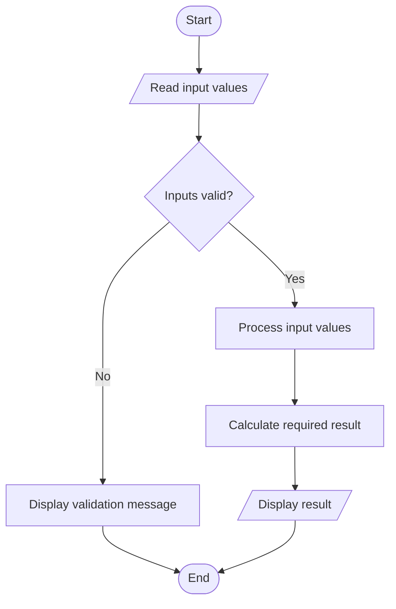

# Flowchart: Numeric Diamond Pattern Generator

This flowchart represents the main logic of `main.py`.

Note: The flowchart is a high-level overview. The program's loops and checks are described in `documentation.md`.
